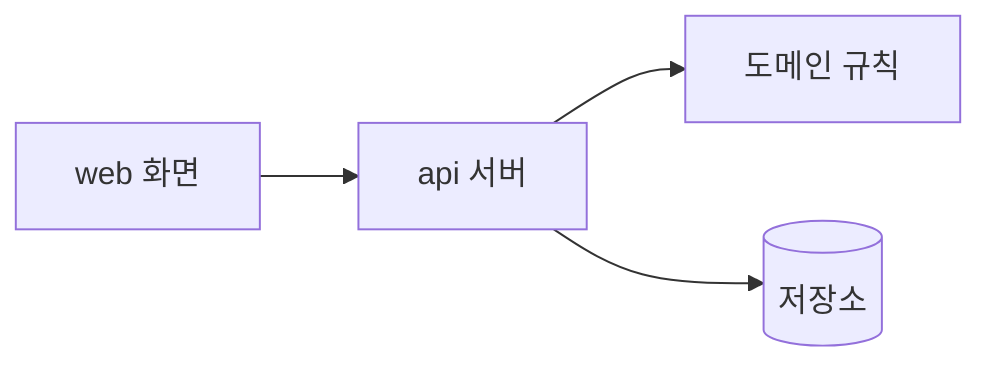
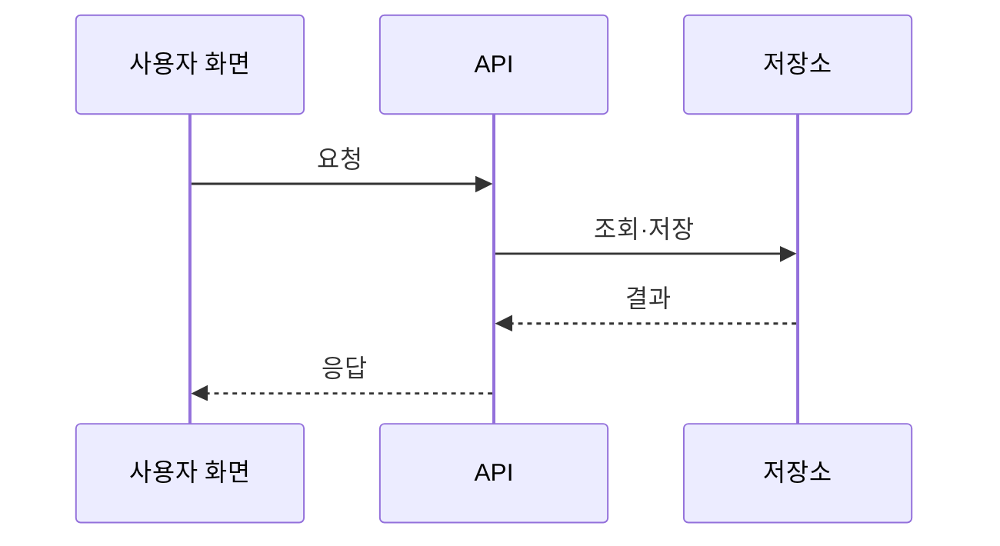

> 연습용 임시 양식 — 주최 측 양식 미제공. 온보딩 개발 문서 안내 기준으로 팀이 작성했으며 주최 양식을 받으면 교체한다.

# Architecture Spine — [서비스 이름]

- **설계 패턴:** [이름 있는 패턴. 예: 계층형, 헥사고날]
- **범위:** [이 문서가 다루는 범위]
- **연결 문서:** docs/prd.md, docs/experience.md

## Design Paradigm (설계 패턴)

[패턴 이름과 계층별 디렉터리 대응. 가장 작고 오래 가는 결정만 적는다.]

## Invariants & Rules (불변 규칙)

[구현 코드만 보고는 알 수 없는 결정을 결정마다 한 블록으로 적는다. 번호는 오름차순으로 매기고 다시 매기거나 재사용하지 않는다. 사용자나 현재 상태로 확정된 결정에는 [ADOPTED]를 붙인다. 아래 블록은 형식 예시다.]

### AD-1 — [결정 이름]

- **Binds (적용 대상):** [요구 ID, 영역, 또는 all]
- **Prevents (막는 어긋남):** [이 결정이 없으면 생길 불일치]
- **Rule (규칙):** [구현이 지켜야 할 검사 가능한 규칙]

의존 방향(누가 누구에 의존할 수 있는지)은 다이어그램으로 적는다.



## Consistency Conventions (일관성 규칙)

| 관심사 | 규칙 |
| --- | --- |
| 이름(엔터티·파일·인터페이스·이벤트) | [규칙] |
| 데이터 형식(ID·날짜·오류 응답·응답 봉투) | [규칙] |
| 상태·공통 처리(변경·오류·로그·설정·인증) | [규칙] |

## Stack

이름과 고정 버전만 적는다. 선택 이유는 결정 기록에 둔다. 아래 행은 형식 예시이며 실제 고정 버전으로 바꾼다.

| Name | Version |
| --- | --- |
| [언어 예: Node.js] | [예: 22.11.0] |

## 데이터 흐름 (입력 → 응답)

[사용자 입력부터 화면 응답까지 거치는 구성 요소와 저장 위치. 다이어그램 아래에 단계별 코드 위치를 적는다.]



| 단계 | 처리 | 코드 위치 |
| --- | --- | --- |
| [입력 수신] | [검증 내용] | [파일 경로] |

## API·데이터·권한 경계

| 경계 | 내용 | 허용 | 거부 시 응답 | 코드 위치 |
| --- | --- | --- | --- | --- |
| [API 경로 또는 데이터 영역] | [다루는 데이터] | [허용 사용자 구분] | [상태 코드와 오류 형식] | [파일 경로] |

## Mock 구분

실제 연동과 목업(Mock)을 구분한다. 목업은 위치와 교체 방법을 함께 적는다.

| 대상 | 구분(실제·목업) | 데이터 위치 | 교체 방법 |
| --- | --- | --- | --- |
| [외부 시스템 또는 데이터] | [실제 또는 목업] | [파일 경로] | [실제 연동 시 바꿀 곳] |

## Structural Seed (구조)

```text
[저장소 루트]/
  [디렉터리]/   # [여기에 두는 것]
```

## Capability → Architecture Map (요구 → 위치)

| 요구 | 구현 위치 | 지배 규칙 |
| --- | --- | --- |
| [요구 ID] | [구성 요소·모듈 경로] | [AD 번호·규칙] |

## 배포·복구·제약

| 항목 | 내용 |
| --- | --- |
| 의존성 | [외부 서비스·패키지와 고정 방식] |
| 배포 | [실행·배포 명령과 환경] |
| 복구 | [데이터 초기화·재시작·되돌리기 방법] |
| 제약 | [기간·환경·데이터 제약] |

## Deferred (미룬 결정)

- [미룬 결정과 지금 정하지 않아도 되는 이유]
