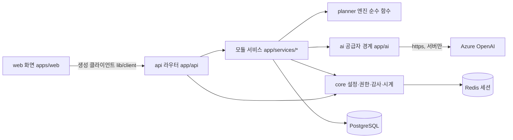
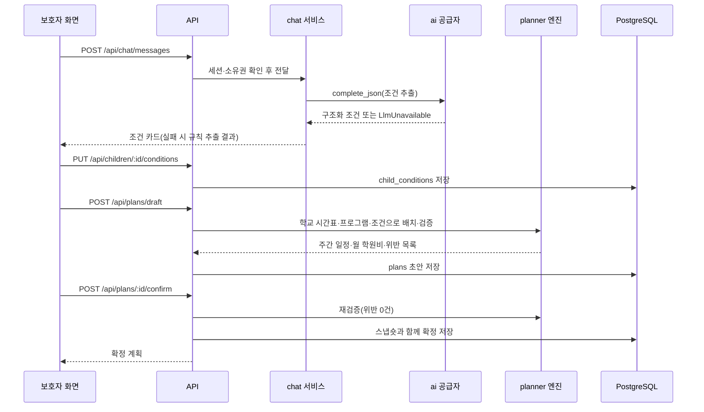

> 연습용 임시 양식 — 주최 측 양식 미제공. 온보딩 개발 문서 안내 기준으로 팀이 작성했으며 주최 양식을 받으면 교체한다.

# Architecture Spine — EDUCONNECT

- **설계 패턴:** 모듈형 모놀리스(Modular Monolith) — 기능 모듈별 세로 단위, 모듈마다 테이블 단일 쓰기 소유
- **범위:** EDUCONNECT 전체 — 기관 웹 입력(학원·학교), 보호자 챗봇·조건, 추천·비교, 주간 일정 생성·수정·확정, 기관 변경 영향·조정, 인증·권한, Azure OpenAI 연동 경계, 시드 데이터. 로컬 compose 데모 기준. API 경로의 `:id`는 경로 변수다
- **연결 문서:** docs/prd.md, docs/experience.md

## Design Paradigm (설계 패턴)

모듈형 모놀리스다. 웹(Next.js) 하나와 API(FastAPI) 하나를 같은 출처로 띄우고(뼈대의 `/api` rewrites), API 안을 기능 모듈로 나눈다. 모듈은 자기 라우터·모델·스키마·서비스 파일을 갖고, 자기 테이블에만 쓴다. 두 개발 흐름은 서로 다른 모듈만 고친다. 레이아웃 파일은 기반 작업이 최종 형태(머리말의 `/api/meta` 표시 자리, 하단 탭·사이드바 메뉴 전체, 로그아웃)로 만들고 이후 고치지 않는다. 기반 작업 이후 `components/kds/`에는 새 파일 추가만 하고 기존 파일은 고치지 않는다.

| 모듈 | 하는 일 | 소유 테이블 | API 파일(`apps/api/app/`) | 웹 경로(`apps/web/`) | 작업 흐름 |
| --- | --- | --- | --- | --- | --- |
| core | 설정·DB·Redis·시계·세션 확인·권한 거부·감사 기록·마스킹·단위 변환·값 목록 | `audit_events`(쓰기는 `core/audit.py`만) | `core/*.py` | `lib/`, `components/kds/`, `app/layout.tsx`, `app/page.tsx`, `app/(parent)/layout.tsx`, `app/(org)/layout.tsx` | 기반 |
| auth | 로그인·로그아웃·잠금·내 정보 | `accounts` | `api/auth.py`, `models/auth.py`, `schemas/auth.py`, `services/auth/` | `app/login/` | dev:1 |
| catalog | 학원 프로그램, 학교 하교 시각·방과후 프로그램, 과목 목록 | `institutions`, `programs`, `school_timetables` | `api/catalog.py`, `models/catalog.py`, `schemas/catalog.py`, `services/catalog/` | `app/(org)/academy/`, `app/(org)/school/`, `components/org/` | dev:1 |
| ai | Azure OpenAI 호출·대역·https 검사·마스킹 | - | `ai/*.py` | - | 기반 + dev:1(#10 검증) |
| seed | 목업 데이터 적재·초기화, 시험 라우트 | (모든 테이블 적재 예외 — AD-2) | `seed/`, `api/testing.py` | - | dev:1 |
| family | 자녀 프로필 | `children` | `api/family.py`, `models/family.py`, `schemas/family.py`, `services/family/` | `app/(parent)/children/` | dev:1 (PUT은 #6에서 선행) |
| chat | 챗봇 대화, 조건 추출(LLM·규칙), 조건 저장 | `child_conditions` | `api/chat.py`, `models/chat.py`, `schemas/chat.py`, `services/chat/` | `app/(parent)/chat/`, `components/parent/` | dev:2 |
| planner | 추천·비교, 일정 엔진, 계획 초안·확정, 영향·조정, 서비스 메타 | `plans` | `api/planner.py`, `api/meta.py`, `models/planner.py`, `schemas/planner.py`, `services/planner/` | `app/(parent)/schedule/`, `app/(org)/impact/`, `components/impact/` | dev:2 (서비스 메타(#12)는 dev:1) |

작업 흐름 2개(기반 작업은 dev:1이 먼저 끝낸다):

- **dev:1 (AILIEN_BUILDER) — 기반과 기관 웹:** 기반 작업 → REQ-11 시드(#11) → REQ-01 인증 강화(#1) → REQ-02 학원 프로그램(#2) → REQ-03 학교 시간표(#3) → REQ-12 모두의 AI 표현(#12) → REQ-04 자녀(#4) → REQ-13 접근성(#13) → REQ-10 비밀값 보호 검증(#10). 기반 외 선행: #2는 #6 뒤(AC-02.4·02.5·02.6이 보호자 추천 결과를 본다), #3은 #6·#7 뒤(AC-03.2 일정·AC-03.3 추천), #4는 #7 뒤(AC-04.2·04.5가 일정 생성 결과를 본다)이고 자녀 PUT은 #6이 먼저 넣는다, #13은 #2·#3·#4·#5·#8 뒤(모든 화면 axe 검사), #10은 #5·#6·#8 뒤(AC-10.1·AC-10.4가 FLOW-01 실행 결과를 검사). #2·#3의 화면·API는 선행이 끝나기 전에 만들고, 선행에 걸린 확인 조건만 뒤에 시험한다.
- **dev:2 (AILIEN_PLANNER) — 보호자 챗봇·추천·일정:** REQ-05 챗봇 조건(#5) → REQ-06 추천(#6) → REQ-07 일정(#7) → REQ-08 선택·확정(#8) → REQ-09 영향·조정(#9). 기반 외 선행: #5는 #11 뒤(시드 보호자·자녀), #6·#7은 #5·#11 뒤(저장된 조건·기준 시나리오 데이터), #8은 #7 뒤, #9는 #2·#3·#8 뒤(기관 수정 화면과 확정 계획이 필요). #11을 기다리는 동안 정적 화면·엔진 순수 함수 단위 시험부터 한다.

## Invariants & Rules (불변 규칙)

### AD-1 — 모듈 경계와 파일 소유 [ADOPTED]

- **Binds (적용 대상):** all
- **Prevents (막는 어긋남):** 두 개발 흐름이 같은 파일을 동시에 고쳐 병합 충돌이 나거나, 한 기능의 코드가 여러 모듈에 흩어지는 것
- **Rule (규칙):** 코드는 위 모듈 표의 파일 위치에만 둔다. 한 모듈의 서비스는 다른 모듈의 서비스 함수를 호출하지 않는다(읽기는 AD-2의 SELECT만). 공용 코드는 `core/`와 `ai/`뿐이며 기반 작업 이후 `core/`·`ai/` 변경은 dev:1이 PR로 하고 시그니처를 바꾸지 않는다.

### AD-2 — 테이블 단일 쓰기 소유 [ADOPTED]

- **Binds (적용 대상):** REQ-01~REQ-11
- **Prevents (막는 어긋남):** 한 테이블을 두 모듈이 서로 다른 규칙으로 고쳐 데이터가 어긋나는 것
- **Rule (규칙):** 테이블에 INSERT·UPDATE·DELETE하는 코드는 모듈 표의 소유 모듈에만 있다. 다른 모듈은 SQLAlchemy 모델로 SELECT만 한다. 예외는 둘이다. (1) `audit_events`는 `core/audit.py`만 쓴다. (2) `seed`의 적재·초기화 명령과 `/api/test/reset`은 모든 테이블에 쓰되, dev:2 테이블(`children`·`child_conditions`) 행은 소유 모듈의 Pydantic 스키마로 검증한 뒤 넣고 `plans`는 만들지 않는다(시험이 API로 만든다). 테이블 모양을 바꾸는 쪽이 같은 PR에서 시드 JSON도 고친다.

### AD-3 — 기반 작업이 계약을 먼저 고정한다 [ADOPTED]

- **Binds (적용 대상):** 기반 Issue, 모든 REQ
- **Prevents (막는 어긋남):** 기능마다 라우터 등록·모델 import·마이그레이션을 따로 추가해 `main.py`·`alembic/env.py`·마이그레이션 head가 충돌하는 것
- **Rule (규칙):** 기반 작업이 (1) 모든 테이블의 모델과 첫 마이그레이션, (2) 모든 라우터의 `main.py` 등록과 아래 'API·데이터·권한 경계'의 경로·요청·응답 스키마(본문은 501), (3) `npm run gen:api` 결과, (4) 보호자·기관 레이아웃, (5) `core/`의 세션 확인·권한 검사·감사 기록·시계, (6) `ai/` 공급자 경계, (7) compose 포트(AD-12)를 만든다. 이후 기능 PR은 `main.py`·`alembic/env.py`를 고치지 않는다. 스키마를 바꿔야 하면 소유 모듈이 새 마이그레이션을 추가하고, 병합 뒤 head가 둘이면 나중에 병합하는 쪽이 `alembic merge heads` 리비전을 만든다. `apps/web/openapi.json`·`apps/web/lib/client/` 충돌은 손으로 합치지 않고 origin/main을 받은 뒤 `npm run gen:api`를 다시 실행한다.

### AD-4 — 영향은 확정 계획 스냅숏과 현재 기관 데이터를 읽을 때 비교한다

- **Binds (적용 대상):** REQ-02, REQ-03, REQ-08, REQ-09
- **Prevents (막는 어긋남):** 기관 저장 코드가 계획을 직접 고치거나(두 쓰기 소유), 변경 이벤트를 놓쳐 영향 표시가 빠지는 것
- **Rule (규칙):** 계획 확정 시 `plans`에 항목(AD-16 `items`), 요일별 하교 시각(`school_snapshot`), 확정 시점 예산 상한(`budget_cap`)을 함께 저장한다. 영향은 planner가 조회 시점에 계산한다: 현재 `programs`(삭제 포함)·현재 하교 시각·현재 자녀 기존 일정으로 스냅숏 항목을 다시 놓고, 상한은 스냅숏 `budget_cap`으로 엔진 검증을 다시 실행한다. 사유 코드는 `time_overlap`·`travel_short`·`over_budget`(초과 금액)·`content_changed`(시각·금액이 바뀌었으나 위반 없음, 또는 프로그램 삭제)이며, 위반 사유(`time_overlap`·`travel_short`·`over_budget`)가 하나라도 있으면 '영향 있음'이다. catalog는 `plans`를 읽거나 쓰지 않는다. 프로그램 삭제는 `programs.deleted_at`을 채우는 soft delete다. 조정안은 GET 때 엔진으로 결정형 계산하고, 수락 POST는 같은 계산을 다시 해 위반 0건일 때만 새 확정 행을 만들고 이전 행을 `superseded`로 바꾼 뒤 새 ID를 돌려준다. 거절은 아무것도 바꾸지 않는다. 기관 화면의 영향 수는 `GET /api/org/impact?program_id=` 또는 `?grade=`(없으면 기관 전체)가 `{"affected_plans": int, "items": [{"program_id" 또는 "grade", "affected_plans": int}]}`로 돌려주며 자녀·보호자·계획 ID를 넣지 않는다. 기관 저장 결과 줄은 방금 저장한 `program_id`(학교는 `grade`)로 조회한다. 결과 줄의 영향 수 컴포넌트(`components/impact/ImpactSummary.tsx`)는 planner 소유이며 기반 작업이 빈 컴포넌트를 만들고 catalog 화면이 배치만 한다.

### AD-5 — LLM은 말하고 엔진이 판정한다

- **Binds (적용 대상):** REQ-05, REQ-06, REQ-07, REQ-08, REQ-09
- **Prevents (막는 어긋남):** LLM 응답이 시간 중복·예산 초과 일정을 만들거나, 같은 조건에 결과가 달라지는 것
- **Rule (규칙):** LLM은 조건 추출(구조화 출력)과 추천 이유 문장만 만든다. 후보 필터·점수·일정 배치·중복·이동·예산·밀도 판정은 `services/planner/engine.py`의 순수 함수가 한다(DB·네트워크·시계 접근 없음, 외부 최적화 라이브러리 없음). 같은 입력이면 같은 출력이 나오도록 정렬 키를 (점수, 학원명, 프로그램 시작 시각, 프로그램 ID)로 고정한다. 계획 확정·조정 수락 API는 서버에서 엔진 검증을 다시 실행해 위반이 0건일 때만 저장한다.

### AD-6 — 시간·금액·학년 표현

- **Binds (적용 대상):** all
- **Prevents (막는 어긋남):** 모듈마다 시간·요일·학년 형식을 달리 써서 비교·계산이 틀리는 것
- **Rule (규칙):** DB는 시각을 자정부터의 분(int), 요일을 0=월~6=일(int), 금액을 원(int), 학년을 1~6=초1~초6·7~9=중1~중3(int)로 저장한다. API는 시각 `"HH:MM"`, 요일 `"mon"`~`"sun"`, 금액 정수 원, 학년 정수로 주고받는다. 변환은 `core/units.py`에서만 한다. 프로그램은 한 행에 여러 요일(`days int[]`)을 갖고 같은 시각에 수업한다. 월 학원비 = 프로그램별 (월 교습비 + 월 기타경비)를 프로그램당 한 번 더한 합. 과목의 주 횟수 = 그 과목 프로그램들의 요일 수 합. 빼기·바꾸기는 프로그램 단위다. 월 교습비 NULL이 미공개이고 0은 무료다. 미공개 프로그램과 정원=현재 인원인 마감 프로그램은 추천·일정 후보에서 뺀다.

### AD-7 — 이동 근사 계산

- **Binds (적용 대상):** REQ-03, REQ-06, REQ-07, REQ-09
- **Prevents (막는 어긋남):** 추천 비교표와 일정 엔진, 영향 계산이 서로 다른 이동시간을 써서 판정이 엇갈리는 것
- **Rule (규칙):** 이동시간(분) = ceil(하버사인 거리(km) × 1.4 ÷ 15km/h × 60), 최소 5분. 학교에서 첫 수업, 같은 요일 수업 사이에 적용한다. 계산 함수는 `services/planner/travel.py` 하나이고 화면에는 값 옆에 "근사"를 붙인다. 공백 = 다음 시작 − 이전 종료 − 이동시간이며 0보다 작으면 이동 부족이다. 방과후 프로그램은 학교 좌표를 쓰므로 학교와의 이동은 0분이다. 하교 시각이 없는 날(주말 등)은 첫 수업에 이동·공백 규칙을 적용하지 않는다. 장소가 없는 기존 일정은 시간 중복만 보고 이동 계산에서 뺀다. 하교 시각은 학교 시간표 > 자녀 `manual_dismissal` > 없음(`school_timetable_missing`) 순서로 정한다.

### AD-8 — 세션 인증과 권한 판정

- **Binds (적용 대상):** REQ-01, 보호 API 전체
- **Prevents (막는 어긋남):** 라우터마다 인증·소유권 검사를 다르게 해 남의 자원이 보이거나 상태 코드가 섞이는 것
- **Rule (규칙):** 로그인 성공 시 32바이트 임의 토큰을 Redis `educonnect:session:<토큰>`(값: 계정 ID·역할·기관 ID, TTL 8시간)에 두고 쿠키 `ec_session`(HttpOnly, SameSite=Lax, Path=/, Max-Age=28800)으로 준다. 로그아웃은 Redis 키를 지운다. 비밀번호는 `hashlib.scrypt`(n=2^14, r=8, p=1, 16바이트 salt)로 `scrypt$<n>$<r>$<p>$<salt>$<hash>` 형식 저장. 연속 실패 수·잠금 해제 시각은 `accounts` 열에 두고 5회 실패 시 15분 잠근다. 쿠키는 `set_cookie(httponly=True, samesite="lax", max_age=28800, path="/")`로 명시하고 로컬 http라 Secure는 끈다. 모든 보호 라우터는 `core/authz.py`의 `require_role(...)` 의존성으로 세션 없음·만료 401, 역할 불일치 403을 판정한다. 소유권은 각 모듈 쿼리가 세션의 계정·기관 ID 조건으로 거르고, 결과가 없으면 반드시 `core.authz.deny_not_found(session, target)`(감사 기록 후 404)을 호출한다. 라우터에서 `HTTPException(401·403·404)`을 직접 던지지 않는다(grep 시험으로 확인). 웹의 로그인 가드는 레이아웃에서 `GET /api/auth/me`를 부르는 클라이언트 확인이며, 권한 판정의 근거는 항상 서버다.

### AD-9 — 감사 기록

- **Binds (적용 대상):** REQ-01 (AC-01.13), SEC-10
- **Prevents (막는 어긋남):** 사건마다 기록 위치·항목이 달라지거나 비밀값이 기록되는 것
- **Rule (규칙):** 감사 기록은 테이블 `audit_events(id, at, kind, account_id, target)` 하나에 `core/audit.py`의 `record(kind, account_id, target)`로만 쓴다. kind는 `login_success`·`login_failure`·`account_locked`·`logout`·`access_denied_404`·`access_denied_403`. 403·404 거부 시 `core/authz.py`가, 로그인·잠금·로그아웃 시 auth 서비스가 `record`를 호출한다. target은 경로와 자원 ID만 담고 요청 본문·쿠키·헤더·비밀번호·`AZURE_OPENAI_*` 값을 넣지 않는다.

### AD-10 — AI 공급자 경계와 비밀값 보호

- **Binds (적용 대상):** REQ-05, REQ-06, REQ-10, REQ-12
- **Prevents (막는 어긋남):** 기능마다 Azure 호출·오류 처리를 따로 만들어 비밀값이 새거나 대체 경로 전환이 엇갈리는 것
- **Rule (규칙):** LLM 호출은 `ai/port.py`의 `complete_json(task, schema, messages) -> dict`만 쓴다. 실패(키 없음·https 아님·오류·타임아웃 10초·스키마 불일치)는 모두 `LlmUnavailable` 하나로 올라오고, 호출한 모듈이 자기 대체 경로(규칙 추출·템플릿 설명)로 바꾼다. 구현은 `LLM_PROVIDER`로 고른다: `azure`(openai SDK의 `OpenAI(base_url=AZURE_OPENAI_BASE_URL, api_key=...)`, 주소는 https이며 `/openai/v1/`로 끝남, 배포 `AZURE_OPENAI_DEPLOYMENT` 기본 `gpt-5.4-mini`, 구조화 출력은 `response_format` json_schema strict), `fake`(시험 대역: 고정 응답·잘못된 JSON·오류 모드, 요청 본문 기록), `auto`(Azure 변수가 모두 있으면 azure, 없으면 none). 설정은 `core/config.py`가 서버 환경변수에서만 읽고, 웹 코드·`NEXT_PUBLIC_*`에 넣지 않는다. 로그와 오류 응답은 `core/logging.py`의 마스킹 필터를 거친다. 프롬프트에는 자녀 별칭·학년·관심사·조건만 넣는다. 프롬프트·스키마·대체 경로·task 이름 상수(`extract_conditions`, `recommend_reason`)는 호출 모듈(chat·planner)이 소유한다. JSON schema는 Azure strict 부분집합(모든 필드 required, `additionalProperties: false`, 길이·범위 제약 없음)으로 쓰고 범위 검사는 Pydantic 재검증에서 한다. Azure 값 파일은 `--env-file`로만 넘기고 읽거나 출력하지 않으며, `docker compose config`·`docker inspect`·`env`·`printenv`를 쓰지 않는다. 시험은 `SEED_PASSWORD` 값을 출력하지 않는다.

### AD-11 — 시험 라우트는 켤 때만 존재한다

- **Binds (적용 대상):** REQ-01, REQ-05, REQ-06, REQ-10, REQ-11
- **Prevents (막는 어긋남):** 시험용 시계·초기화·대역 조작이 데모 환경에 남거나, 시험마다 조작 방법이 달라지는 것
- **Rule (규칙):** `/api/test/*`(`POST /api/test/reset` 시드 초기화, `POST /api/test/clock`(본문 `advance_minutes`) 시계 이동, `POST /api/test/llm {task, mode: fixed|bad_json|error, response}` 대역 설정, `GET /api/test/llm/requests` 요청 기록)는 `ENABLE_TEST_ROUTES=1`일 때만 라우터에 등록된다. compose 기본값은 0이고 CI·로컬 E2E만 1로 띄운다. 시간은 항상 `core/clock.py`의 `now()`로 읽는다(시계 이동이 잠금 해제에 반영되도록). 대역의 고정 응답 내용은 시험 코드가 보내고 `ai/fake.py`는 내용을 모른다.

### AD-12 — 게시 포트는 loopback 전용 [ADOPTED]

- **Binds (적용 대상):** REQ-10 (AC-10.7), SEC-06, SEC-11
- **Prevents (막는 어긋남):** 같은 망에서 DB·API에 접속되는 것, 같은 PC의 다른 프로젝트와 포트가 충돌하는 것
- **Rule (규칙):** `compose.yml`의 web·api·db·redis `ports`는 모두 `"127.0.0.1:${WEB_PORT:-3000}:3000"` 형식이다(`API_PORT` 8000, `DB_PORT` 15432, `REDIS_PORT` 16379). api 서비스 `environment:`는 `AZURE_OPENAI_*`·`LLM_PROVIDER`·`ENABLE_TEST_ROUTES`·`SEED_PASSWORD`를 `${NAME:-}`로 넘긴다. E2E는 `APP_URL`로 대상 주소를 받고 `localhost`와 `127.0.0.1`을 섞지 않는다(쿠키 분리). 다른 기기 시연은 Daechul Jung의 보안 예외 승인 뒤에만 바꾼다.

### AD-13 — 오류 응답과 화면 표시

- **Binds (적용 대상):** all
- **Prevents (막는 어긋남):** 라우터마다 오류 모양이 달라 화면 처리가 갈라지거나, 서버 오류 원문이 화면에 보이는 것
- **Rule (규칙):** 업무 오류의 4xx 본문은 `{"detail": "<오류 코드>", "data": {...}}`(`data`는 선택)다. 예: `invalid_credentials`, `account_locked`, `time_overlap`, `consent_required`, `not_found`, `no_feasible_plan`(`data.relaxations`는 `budget`·`days`·`subjects` 중 하나 이상), `violations`(`data.violations`). 입력 형식 검증 실패는 FastAPI 기본 422(`detail`이 배열)이고, 웹은 `detail`이 문자열이면 업무 오류, 배열이면 칸 오류로 처리한다. 초안 생성·수정은 위반이 있어도 200으로 `violations: [{program_id, kind, amount}]`를 돌려주고, 409 `violations`는 확정·수락 재검증 실패에만 쓴다. 화면은 오류 코드를 experience의 문구로 바꿔 보이고 원문·상태 코드·설정값을 보이지 않는다. 5xx는 `{"detail": "server_error"}`만 돌려준다.

### AD-14 — 외부 연동은 목업과 어댑터 경계로 둔다 [ADOPTED]

- **Binds (적용 대상):** REQ-11, REQ-12
- **Prevents (막는 어긋남):** 실제 NEIS·지도·모두의 AI 호출이 섞여 시험이 외부 상태에 흔들리는 것
- **Rule (규칙):** 학교·학원·프로그램·좌표는 시드 데이터만 쓴다. 모두의 AI 연동 상태는 `GET /api/meta`가 `"mock"`으로 돌려주고 화면은 "모의"로 보인다. 외부 지도·경로 API는 호출하지 않는다.

### AD-15 — 값 목록은 한 곳에 둔다

- **Binds (적용 대상):** REQ-02, REQ-03, REQ-05, REQ-06
- **Prevents (막는 어긋남):** 조건은 코드, 프로그램은 한국어 라벨로 저장해 필터 결과가 0행이 되거나, 고정 과목 목록 때문에 새 과목(피아노·로봇)을 고르지 못하는 것
- **Rule (규칙):** 프로그램 유형 코드 `academy`(교과 학원)·`arts`(예체능 학원)·`other`(기타)·`after_school`(방과후)와 화면 라벨, 요일 코드는 `core/vocab.py`에만 둔다. 과목은 앞뒤 공백을 지운 한국어 문자열로 저장하고 정확히 같을 때만 일치한다. 조건 카드의 과목 칩 목록은 `GET /api/catalog/subjects`(삭제되지 않은 프로그램 과목의 중복 없는 목록, catalog 소유)로 받는다.

### AD-16 — 공유 데이터 모양

- **Binds (적용 대상):** REQ-03, REQ-04, REQ-05, REQ-07, REQ-08, REQ-09, REQ-11
- **Prevents (막는 어긋남):** 기반 작업과 기능 PR, 시드가 같은 열을 서로 다른 키·단위로 채우는 것
- **Rule (규칙):** DB 값은 AD-6 정수 단위다. `programs`: `institution_id, type, subject, days int[], start_min, end_min, monthly_tuition int NULL, monthly_other int, instructor, grade_min, grade_max, capacity, enrolled, lat NULL, lng NULL, deleted_at NULL`(방과후는 `institution_id`=학교, 좌표가 없으면 학교 좌표). `school_timetables`: 유일 키 `(school_id, grade, dow)`, `dismissal_min`. `children`: `parent_id, alias, age, grade, school_id NULL, interests text[], goal, existing_events jsonb [{"dow", "start_min", "end_min", "label"}], manual_dismissal jsonb {"<dow>": min}, consent_checked bool` — 실명·연락처 열 없음. `child_conditions`(자녀당 1행): `subjects text[], budget_target, budget_cap, types text[], days int[], density`(`tight`·`normal`). `plans`: `child_id, status`(`draft`·`confirmed`·`superseded`), `items jsonb [{"program_id", "days", "start_min", "end_min", "monthly_tuition", "monthly_other", "subject"}]`, `school_snapshot jsonb {"<dow>": min}`, `budget_cap, monthly_total, created_at`. 시드 배정은 보호자 1 → 초5 자녀(초등학교), 보호자 2 → 중1 자녀(중학교)다. 챗봇 요청은 `{child_id, text}`이고 대상 자녀는 `child_id`가 정한다(LLM이 추출한 학년은 표시용).

의존 방향(누가 누구에 의존할 수 있는지)은 다이어그램으로 적는다.



## Consistency Conventions (일관성 규칙)

| 관심사 | 규칙 |
| --- | --- |
| 이름(엔터티·파일·인터페이스·이벤트) | 테이블은 복수 snake_case(`programs`), 모델 클래스는 단수 PascalCase(`Program`), 모듈 파일은 모듈 이름(`catalog.py`). API 경로는 `/api/<모듈 영역>/<복수 자원>`, 라우트 함수 이름이 operation id이자 생성 클라이언트 함수 이름이다(`list_programs`). 웹 라우트 그룹은 `(parent)`·`(org)`. 감사 kind는 snake_case 동사구 |
| 데이터 형식(ID·날짜·오류 응답·응답 봉투) | ID는 UUID 문자열. 시각 기록(`created_at`·`at`)은 UTC ISO 8601. 하루 안 시각·요일·금액·학년은 AD-6. 응답은 봉투 없이 자원 JSON 또는 배열. 오류는 AD-13 |
| 상태·공통 처리(변경·오류·로그·설정·인증) | 쓰기는 소유 모듈 서비스에서 한 트랜잭션(AD-2). 설정은 `core/config.py`(pydantic-settings, 환경변수)만 읽는다. 로그는 `core/logging.py` 마스킹 필터를 거친다. 인증·권한은 `core/authz.py` 의존성(AD-8). 웹 서버 상태는 TanStack Query, 변경 뒤 관련 쿼리 무효화. UI는 KDS 2.0(`kds-design`), `kds-lint` error 0 |

## Stack

이름과 고정 버전만 적는다. 선택 이유는 결정 기록에 둔다.

| Name | Version |
| --- | --- |
| Node.js | 24.18.0 |
| Next.js | 16.4.0 |
| React | 19.3.0 |
| TypeScript | 5.9.3 |
| Tailwind CSS | 4.3.3 |
| TanStack Query | 5.104.1 |
| @hey-api/openapi-ts | 0.99.0 |
| vitest | 5.0.3 |
| e2e (하네스 러너) | 0.18.0 |
| Python | 3.14 |
| FastAPI | 0.142.2 |
| Pydantic | 2.13.5 |
| SQLAlchemy | 2.1.3 |
| Alembic | 1.20.0 |
| psycopg | 3.3.6 |
| openai (Python SDK, Azure OpenAI v1 호출) | 3.28.0 |
| PostgreSQL + pgvector | pgvector/pgvector:0.8.7-pg18-trixie |
| Redis | 8.10 (redis:8.10-alpine) |

## 데이터 흐름 (입력 → 응답)

핵심 흐름(FLOW-01): 보호자가 챗봇에 조건을 말하고 일정을 확정하기까지.



| 단계 | 처리 | 코드 위치 |
| --- | --- | --- |
| 입력 수신 | 세션 확인, 역할 보호자, 자녀 소유권(아니면 404). 문장 길이 1~500자 | `app/core/authz.py`, `app/api/chat.py` |
| 조건 추출 | LLM 구조화 출력 → Pydantic 스키마 검증, 실패 시 규칙 추출로 같은 스키마 | `app/services/chat/extract.py`, `app/ai/port.py` |
| 조건 저장 | 예산 상한 ≥ 목표 예산, 요일·과목 허용 값 검증 후 자녀별 1행 upsert | `app/services/chat/conditions.py` |
| 추천 | 학년·과목·유형·요일·정원·미공개 필터, 점수 정렬, 이유는 LLM 또는 템플릿 | `app/services/planner/recommend.py`, `app/services/planner/engine.py` |
| 일정 생성 | 학교 하교 시각·기존 일정·이동 근사로 배치, 중복·이동·예산·밀도 판정 | `app/services/planner/engine.py`, `app/services/planner/travel.py` |
| 확정 | 엔진 재검증 위반 0건일 때 스냅숏 저장, 같은 자녀의 이전 확정 계획은 superseded | `app/services/planner/plans.py` |
| 영향 | 조회 시 스냅숏과 현재 기관 데이터 비교, 조정안은 엔진으로 재배치 | `app/services/planner/impact.py` |

## API·데이터·권한 경계

| 경계 | 내용 | 허용 | 거부 시 응답 | 코드 위치 |
| --- | --- | --- | --- | --- |
| `POST /api/auth/login`, `POST /api/auth/logout`, `GET /api/auth/me` | 로그인·로그아웃·내 계정(ID·역할·기관) | 로그인은 모두, 나머지는 로그인 사용자 | 401 `invalid_credentials`·`account_locked`·`unauthenticated` | `app/api/auth.py` |
| `GET·POST /api/academy/programs`, `PUT·DELETE /api/academy/programs/:id` | 자기 학원 프로그램(교습비·기타경비 분리, 정원, 좌표) | 학원 담당자(자기 학원) | 401, 403(다른 역할), 404(남의 학원), 422 | `app/api/catalog.py` |
| `GET·PUT /api/school/timetable`, `GET·POST /api/school/after-school`, `PUT·DELETE /api/school/after-school/:id` | 자기 학교 학년·요일별 하교 시각, 방과후 프로그램 | 학교 담당자(자기 학교) | 401, 403, 404, 422 `time_overlap` | `app/api/catalog.py` |
| `GET·POST /api/children`, `GET·PUT /api/children/:id` | 자기 자녀(별칭·만 나이·학년·학교·관심사·교육 목표·기존 일정·하교 시각 직접 입력·동의 확인). 실명·연락처 없음 | 보호자(자기 자녀) | 401, 403, 404, 422 `consent_required` | `app/api/family.py` |
| `POST /api/chat/messages`, `GET·PUT /api/children/:id/conditions` | 대화 1회 응답(조건 초안·출처 llm/fallback), 자녀별 조건 | 보호자(자기 자녀) | 401, 403, 404, 422 | `app/api/chat.py` |
| `GET /api/catalog/subjects` | 삭제되지 않은 프로그램 과목 목록(AD-15) | 로그인 사용자 | 401 | `app/api/catalog.py` |
| `GET /api/catalog/schools` | 자녀 등록 폼의 학교 선택지(시드 학교 `id`·`name`만, 좌표·담당자 없음) | 로그인 사용자 | 401 | `app/api/catalog.py` |
| `POST /api/recommendations` | 자녀 조건 기준 비교표 | 보호자(자기 자녀) | 401, 403, 404 | `app/api/planner.py` |
| `POST /api/plans/draft`, `GET /api/plans`, `GET·PUT /api/plans/:id`, `POST /api/plans/:id/confirm` | 초안 생성·수정(빼기·바꾸기), 확정, 목록(영향 표시 포함) | 보호자(자기 계획) | 401, 403, 404, 409 `violations`, 422 `no_feasible_plan` | `app/api/planner.py` |
| `GET /api/plans/:id/adjustment`, `POST /api/plans/:id/adjustment/accept`, `POST /api/plans/:id/adjustment/reject` | 영향 사유, 조정안, 수락·거절 | 보호자(자기 계획) | 401, 403, 404, 422 `no_feasible_plan` | `app/api/planner.py` |
| `GET /api/org/impact?program_id=·?grade=` | 이 기관 변경으로 영향받는 확정 계획 수(전체·항목별, AD-4 모양). 자녀·보호자·계획 ID 없음 | 학원·학교 담당자(자기 기관) | 401, 403 | `app/api/planner.py` |
| `GET /api/meta`, `GET /api/health` | 서비스 이름·부제, 모두의 AI 상태 `mock`, AI 공급자 표기 "Azure OpenAI(국내 리전)", 상태 점검 | 모두 | - | `app/api/meta.py`, `app/api/health.py` |
| `/api/test/*` | 시드 초기화, 시계 이동, LLM 대역 모드·요청 기록 | `ENABLE_TEST_ROUTES=1`일 때만 존재 | 404(꺼져 있음) | `app/api/testing.py` |
| DB `accounts`, `audit_events` | 계정·해시·잠금, 감사 기록 | `accounts`는 auth 모듈만, `audit_events`는 `core/audit.py`만 쓰기 | - | `app/models/auth.py` |
| DB `institutions`, `programs`, `school_timetables` | 기관·프로그램(방과후 포함, soft delete)·학년·요일별 하교 시각(AD-16) | catalog 모듈만 쓰기 | - | `app/models/catalog.py` |
| DB `children`, `child_conditions`, `plans` | 자녀, 자녀별 조건, 계획(초안·확정·superseded, 스냅숏) — 열 모양은 AD-16 | 각각 family·chat·planner만 쓰기 | - | `app/models/family.py`, `app/models/chat.py`, `app/models/planner.py` |

## Mock 구분

| 대상 | 구분(실제·목업) | 데이터 위치 | 교체 방법 |
| --- | --- | --- | --- |
| 학교 2곳(초등 1·중학교 1), 정규 시간표·방과후 | 목업 | `apps/api/app/seed/data/schools.json` | NEIS 학교기본정보·시간표 어댑터를 `seed`와 같은 모델로 적재하는 모듈 추가 |
| 학원 5곳과 프로그램 | 목업 | `apps/api/app/seed/data/academies.json` | NEIS 학원교습소정보로 기관 기본 정보 적재(요일·시간은 기관 입력 유지) |
| 시드 계정(보호자 2·학원 담당자 2 이상·학교 담당자 2)과 데모 자녀 2명 | 목업 | `apps/api/app/seed/data/accounts.json`, `apps/api/app/seed/data/children.json`. 시드 비밀번호는 저장소에 두지 않고 `SEED_PASSWORD` 환경변수(.env)로 받는다 | 실제 회원가입·본인인증으로 교체(범위 밖) |
| 좌표·이동시간 | 목업(시드 좌표 + 하버사인 근사) | 시드 JSON, `app/services/planner/travel.py` | 지도 경로 API 어댑터로 `travel.py` 구현 교체 |
| 모두의 AI 플랫폼 | 목업(어댑터 경계, 상태 "모의") | `app/api/meta.py` | 공개 API가 확인되면 `ai/`에 공급자 구현 추가 |
| Azure OpenAI | 실제(로컬 `ai` 태그 E2E·데모) / 대역(기본 시험·CI) | `app/ai/azure.py`, `app/ai/fake.py` | `LLM_PROVIDER` 값으로 전환 |

## Structural Seed (구조)

```text
EDUCONNECT/
  compose.yml                 # 127.0.0.1 게시 포트, *_PORT 환경변수 (AD-12)
  .env.example                # 변수 이름만 (AZURE_OPENAI_*, *_PORT, SEED_PASSWORD, LLM_PROVIDER, ENABLE_TEST_ROUTES)
  apps/api/app/
    main.py                   # 모든 라우터 등록 (기반 작업만 수정)
    core/                     # config, db, redis, clock, authz, audit, logging, units
    ai/                       # port, azure, fake, none
    api/                      # auth, catalog, family, chat, planner, meta, testing, health
    models/                   # auth, catalog, family, chat, planner (모듈별 파일)
    schemas/                  # 모듈별 요청·응답 Pydantic 모델
    services/<모듈>/          # 모듈 서비스 (planner/engine.py·travel.py는 순수 함수)
    seed/                     # 적재·초기화 명령, data/*.json
  apps/api/alembic/versions/  # 0002 전체 테이블(기반), 이후 소유 모듈별 추가
  apps/web/app/
    login/                    # 로그인
    (parent)/                 # 하단 탭 레이아웃: chat, schedule, children
    (org)/                    # 사이드바 레이아웃: academy, school, impact
  apps/web/components/        # kds/, org/, parent/, impact/
  tests/*.e2e.ts              # TC별 E2E (e2e 러너)
```

## Capability → Architecture Map (요구 → 위치)

| 요구 | 구현 위치 | 지배 규칙 |
| --- | --- | --- |
| REQ-01 | `app/api/auth.py`, `app/services/auth/`, `app/core/authz.py`, `app/core/audit.py`, `apps/web/app/login/` | AD-8, AD-9, AD-11, AD-13 |
| REQ-02 | `app/api/catalog.py`, `app/services/catalog/programs.py`, `apps/web/app/(org)/academy/` | AD-2, AD-4, AD-6 |
| REQ-03 | `app/api/catalog.py`, `app/services/catalog/school.py`, `apps/web/app/(org)/school/` | AD-2, AD-4, AD-6 |
| REQ-04 | `app/api/family.py`, `app/services/family/`, `app/api/catalog.py`(`list_schools`), `apps/web/app/(parent)/children/` | AD-2, AD-6, AD-8 |
| REQ-05 | `app/api/chat.py`, `app/services/chat/`, `apps/web/app/(parent)/chat/` | AD-5, AD-10, AD-13 |
| REQ-06 | `app/services/planner/recommend.py`, `app/services/planner/engine.py`, `app/services/planner/travel.py` | AD-5, AD-6, AD-7, AD-10 |
| REQ-07 | `app/services/planner/engine.py`, `app/services/planner/plans.py`, `apps/web/app/(parent)/schedule/` | AD-5, AD-6, AD-7 |
| REQ-08 | `app/services/planner/plans.py`, `apps/web/app/(parent)/schedule/` | AD-4, AD-5 |
| REQ-09 | `app/services/planner/impact.py`, `apps/web/app/(org)/impact/`, `apps/web/components/impact/` | AD-4, AD-5, AD-8 |
| REQ-10 | `app/ai/`, `app/core/config.py`, `app/core/logging.py`, `compose.yml`, `.env.example`, `tests/` 저장소·빌드 검사 | AD-10, AD-11, AD-12 |
| REQ-11 | `app/seed/`, `app/api/testing.py` | AD-2, AD-6, AD-11, AD-14 |
| REQ-12 | `app/api/meta.py`(값), `apps/web/app/(parent)/chat/`(공급자 표기). 머리말 표시 자리는 기반 작업의 레이아웃 | AD-10, AD-14 |
| REQ-13 | 모든 화면, `tests/a11y.e2e.ts` | Consistency Conventions(KDS 2.0, kds-lint) |

## 배포·복구·제약

| 항목 | 내용 |
| --- | --- |
| 의존성 | 외부 서비스는 Azure OpenAI(선택, 없으면 대체 경로) 하나. Python은 `uv.lock`, 웹은 `package-lock.json`으로 고정. 새 의존성은 `openai==3.28.0` 하나(기반 작업에서 `uv add`) |
| 배포 | 로컬 compose 데모: `docker compose --env-file .env --env-file "$HOME/.config/educonnect/azure-openai.env" up --build --wait` 뒤 `npm run seed`(시드 적재, #11이 스크립트 추가). Azure 값 파일은 경로로만 넘긴다(AD-10). 키 없이 띄우면 `LLM_PROVIDER=auto`가 대체 경로로 동작. 저장소·CI 시크릿은 쓰지 않는다 |
| 복구 | 데이터 초기화는 시드 초기화 명령(`npm run seed -- --reset`, 시험은 `/api/test/reset`). 전체 초기화는 `docker compose down -v` 후 다시 띄우고 `npm run migrate`·`npm run seed` |
| 제약 | 연습 과제, 마감 사람 미지정. 로컬 단일 PC(포트는 AD-12 환경변수로 조정). 데모용 운영 수준. 외부 지도·NEIS·모두의 AI 호출 없음 |

## Deferred (미룬 결정)

- 대화 기록 저장 — 조건은 자녀별로 저장되므로 대화 원문은 저장하지 않는다. 대화 이어 보기 요구가 생기면 chat 모듈 테이블로 추가한다.
- 벡터 검색·임베딩 — 후보가 학원 5곳 규모라 필터·점수로 충분하다. 자유 문장 검색 요구가 생기면 pgvector로 추가한다.
- 외부 최적화 라이브러리(OR-Tools CP-SAT 등) — 시드 규모에서는 순수 함수 탐색으로 결정형 결과를 낸다. 후보가 수백 개로 늘면 엔진 함수 내부만 교체한다(AD-5 계약 유지).
- 백그라운드 작업·파일 저장 — 영향은 조회 시 계산(AD-4)이라 큐가 필요 없고, 파일 업로드 요구가 없다.
- 기본 배포 `gpt-5.4-mini`의 구조화 출력 지원 — Azure 문서의 지원 모델 목록에서 확인되지 않았다(정대철_테스트 사전 시험은 성공). AC-05.7(`ai` 태그) 실행으로 확정하고, 실패하면 `AZURE_OPENAI_DEPLOYMENT`만 바꾼다.
- 운영 배포(클라우드·HTTPS 종단·관측) — 범위가 로컬 데모다. 다른 기기 시연이 필요하면 보안 예외 승인(Daechul Jung) 뒤 정한다.
